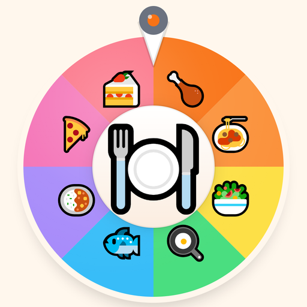
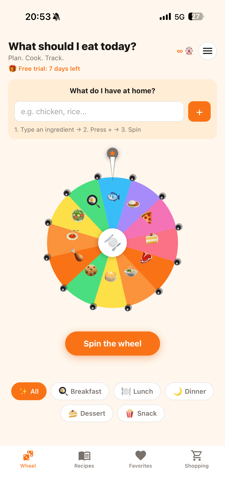
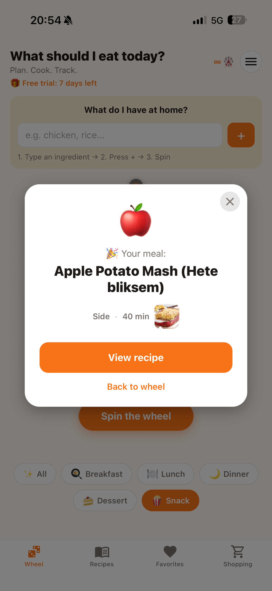
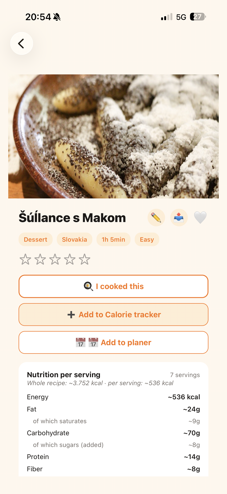
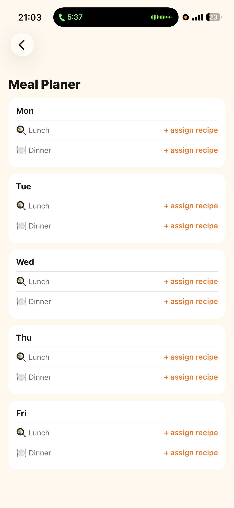

<p align="center">
  
</p>

<h1 align="center">Planeat: what to eat today?</h1>

<p align="center">
  <b>Plan. Cook. Track.</b><br />
  Can't decide what to eat? Spin the wheel and get a recipe, then plan your week and shop for it.
</p>

<p align="center">
  <a href="https://apps.apple.com/app/id6806250997">
    
  </a>
  &nbsp;
  <a href="https://play.google.com/store/apps/details?id=com.antonijeknezevic.planeat">
    
  </a>
</p>

<p align="center">
  <a href="https://github.com/antonijek/Planeat-What-to-Eat/actions/workflows/mobile-checks.yml">
    
  </a>
</p>

<p align="center">
  
  
  
  
</p>

## Features

**Free**

- 🎡 A recipe wheel with meal-moment filters: breakfast, lunch, dinner, dessert and snack
- 📖 789 recipes with search, calories and macros per serving
- 👥 A people counter that scales ingredient amounts
- ❤️ Favorites, pinned recipes and 1–5 ratings

**Premium** (7-day free trial, starts automatically)

- 🥕 "What do I have at home?": find recipes by ingredients you already have
- 🗓️ A weekly meal planner that builds the shopping list for you
- 🛒 A shopping list with your own items
- 🔥 A calorie and macro tracker, cooking history and stats
- ✍️ Your own recipes, plus edits to any recipe with "restore original"
- ♾️ Unlimited spins (free users get 5 a day)

**Everywhere**

- No ads and no account. Everything is stored on the device.
- 7 languages: English, German, Spanish, French, Italian, Portuguese and Serbian
- Light, dark and system themes

## Tech stack

- [Expo](https://expo.dev) SDK 54 and React Native, written in TypeScript (strict)
- React Navigation (bottom tabs and a stack), with Zustand for state
- AsyncStorage for local data
- react-native-reanimated for the wheel and expo-audio for the tick sound
- expo-iap for in-app purchases, plus i18next for translations
- Jest (jest-expo) for tests. GitHub Actions runs the TypeScript check and the tests on every push.

## Project structure

```
data/        recipe database and nutrition sources (build-time)
scripts/     one-off scripts that fetch, enrich and validate the database
mobile/      the Expo app
  src/
    screens/     one file per screen
    components/  shared UI
    services/    data access layer, the boundary for a future backend
    store/       Zustand stores
    storage/     AsyncStorage helpers
    utils/       pure functions, covered by tests
    i18n/        UI translations
```

See [AGENTS.md](AGENTS.md) for detailed development notes (in Serbian).

## Running locally

```bash
cd mobile
npm install
npm start          # Expo dev server (Expo Go or emulator)
```

Checks:

```bash
npx tsc --noEmit   # TypeScript
npm test           # Jest
```

## Data sources

- Recipes: [TheMealDB](https://www.themealdb.com)
- Nutrition: calculated per ingredient from [USDA FoodData Central](https://fdc.nal.usda.gov). Values are
  approximate.

## Links

- Website: [antonije.dev/planeat](https://antonije.dev/planeat)
- [Privacy policy](https://antonije.dev/planeat/privacy)
- [Support](https://antonije.dev/planeat/support)
